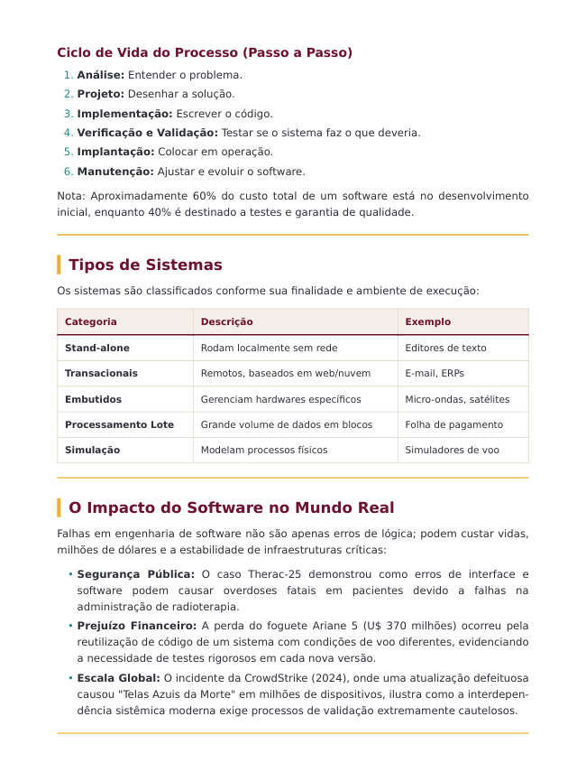
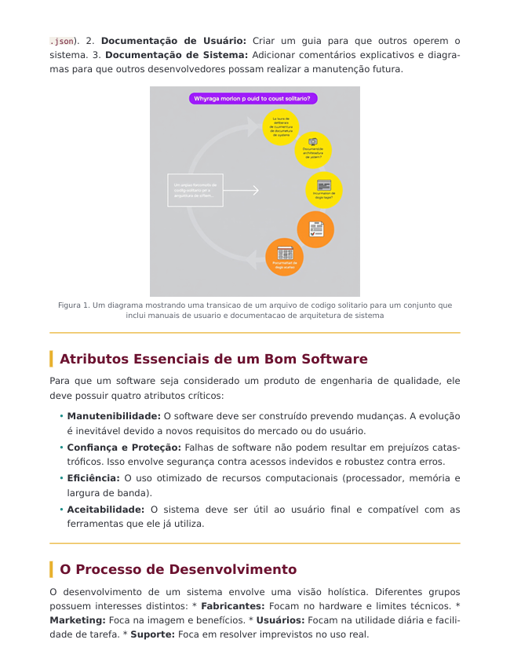
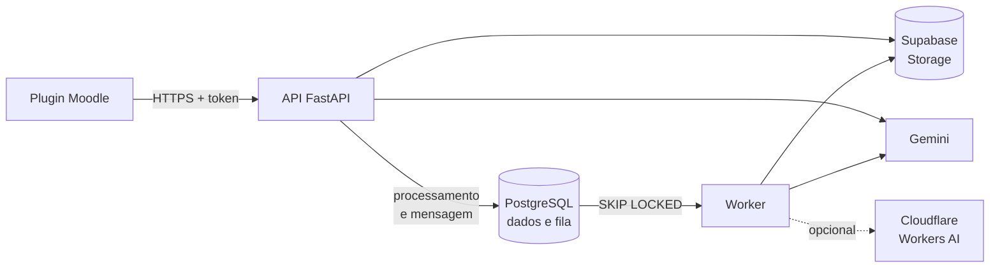
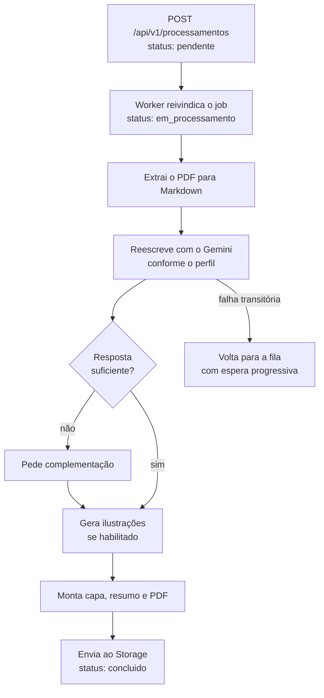

# MPI: Personalização Inteligente de Materiais Didáticos

Backend que reescreve materiais didáticos em PDF para o estilo de aprendizagem de cada estudante. O professor envia o material uma vez; cada aluno recebe uma versão adaptada ao seu perfil no modelo de **Felder-Silverman**, gerada com o **Gemini** e devolvida como um novo PDF.

Projeto de iniciação científica (PIBIC) da Universidade Federal do Maranhão, construído para ser consumido por um plugin do Moodle.


## Demonstração

Páginas de um material gerado pelo sistema a partir de um PDF de Engenharia de Software.

<table>
  <tr>
    <th width="33%">Capa institucional</th>
    <th width="33%">Conteúdo adaptado</th>
    <th width="33%">Ilustração gerada</th>
  </tr>
  <tr>
    <td></td>
    <td></td>
    <td></td>
  </tr>
  <tr>
    <td><sub>Título e abertura do próprio material.</sub></td>
    <td><sub>Listas, tabela e exemplos para o perfil.</sub></td>
    <td><sub>Figura opcional junto ao tópico.</sub></td>
  </tr>
</table>

## Como funciona

O aluno responde ao questionário de estilos de aprendizagem e recebe um perfil em quatro dimensões. Ao pedir um material, a API registra a solicitação e responde na hora; um Worker extrai o conteúdo do PDF, pede ao Gemini uma reescrita orientada ao perfil e monta o novo documento.

| Dimensão | Polos | O que muda no material |
|---|---|---|
| Processamento | Ativo / Reflexivo | Atividades e exercícios, ou pausas para reflexão e sínteses |
| Percepção | Sensorial / Intuitivo | Fatos e exemplos concretos, ou princípios e relações conceituais |
| Entrada | Visual / Verbal | Tabelas, listas e esquemas, ou explicações escritas detalhadas |
| Compreensão | Sequencial / Global | Passos em ordem lógica, ou visão geral antes dos detalhes |

## Funcionalidades

- **Personalização por perfil.** Reescrita guiada pelas quatro dimensões, com histórico de perfis e checagem automática de qualidade: se a resposta vier rasa, o Worker pede uma complementação.
- **Processamento assíncrono e resiliente.** Fila no próprio PostgreSQL, repetição com espera progressiva em falhas transitórias do provedor, recuperação de jobs travados e garantia de que um processamento nunca gera dois materiais.
- **PDF pronto para o aluno.** Capa institucional, resumo e ilustrações geradas por IA (opcionais), entregues por URL assinada e temporária.
- **Dados para a pesquisa.** Sorteio de grupo experimental, registro de interações e progresso de leitura de cada aluno.

## Arquitetura

Clean Architecture: as dependências apontam para dentro, e o domínio não conhece framework, banco nem provedor de IA.



| Camada | Responsabilidade |
|---|---|
| `domain` | Entidades e regras de negócio, sem I/O. |
| `application` | Casos de uso e portas (repositórios, Storage, LLM, fila, imagens). |
| `infrastructure` | Implementações: SQLAlchemy, Supabase, Gemini, Cloudflare, fila e pipeline de PDF. |
| `presentation` | API FastAPI: rotas, schemas, autenticação e middlewares. |
| `worker` | Processo que consome a fila e executa a personalização. |

**Decisões técnicas**

- **Fila no PostgreSQL** com `SELECT ... FOR UPDATE SKIP LOCKED`: dispensa um broker externo e permite vários Workers sem disputa pelo mesmo job. O processamento e a mensagem são gravados na mesma transação.
- **API leve, Worker pesado.** A API não espera a reescrita nem renderiza PDF: responde `202` e o cliente acompanha o status. A única chamada síncrona ao Gemini é a descrição curta do perfil.
- **Falha sem perder trabalho.** Se a ilustração falhar, o PDF sai só com o texto, sem repetir chamadas pagas. Erros definitivos encerram o job com mensagem genérica, e o detalhe fica no log.

### Fluxo de um processamento



## Tecnologias

| Área | Ferramentas |
|---|---|
| Linguagem e API | Python 3.13, FastAPI, Uvicorn, Pydantic v2 |
| Banco de dados | PostgreSQL 16, SQLAlchemy 2.0 assíncrono, asyncpg, Alembic |
| IA | Gemini (`google-genai`), Cloudflare Workers AI para imagens |
| PDF | pymupdf4llm, Markdown, WeasyPrint |
| Armazenamento | Supabase Storage via `httpx` |
| Segurança | Token de serviço com comparação em tempo constante, validação estrita com Pydantic, rate limiting, security headers, CORS por ambiente, URLs assinadas, renderização sem rede e role de banco de privilégio mínimo |
| Observabilidade | Logs estruturados em JSON com id de correlação, `/health`, `/ready` e heartbeat do Worker |
| Infraestrutura | Docker, Docker Compose com limites de CPU e memória, GitHub Actions |
| Qualidade | pytest, Ruff, mypy, Locust, uv |

## Qualidade

- **Mais de 1.400 testes automatizados:** 1.171 de unidade, 140 de API e 94 de integração contra um PostgreSQL real.
- **Tipagem e lint sem pendências:** mypy e Ruff limpos em todo o código da aplicação.
- **CI no GitHub Actions** rodando lint, formatação, tipos e a suíte completa em todo pull request para `main`.
- **Teste de carga com Locust** (execução de fumaça, 99 requisições): mediana de 9 ms, rate limit barrando o excedente com `429`, todos os processamentos aceitos concluídos, fila drenada e nenhum material duplicado.

| Pasta | O que cobre |
|---|---|
| `tests/unit` | Domínio, casos de uso, adaptadores e pipeline, sem rede. |
| `tests/integration` | Repositórios, fila e Worker contra o PostgreSQL. |
| `tests/api` | Rotas de ponta a ponta, incluindo autenticação, CORS e rate limit. |
| `tests/security` | Validação do token de serviço. |

## Segurança

O sistema recebe PDFs de terceiros, envia conteúdo a um LLM externo e guarda dados de estudantes, então a segurança entrou no desenho desde o início:

- autenticação e limite de corpo aplicados **antes** de qualquer parse da requisição;
- checagem de posse por `aluno_id` contra acesso a dados de outro aluno (BOLA/IDOR);
- limites de tamanho, páginas e pixels por PDF, com timeout por etapa do pipeline;
- conteúdo do PDF tratado sempre como dado, nunca como instrução ao modelo;
- respostas de erro genéricas, sem detalhes internos.

O modelo de ameaças completo e as limitações conhecidas estão em [SECURITY.md](SECURITY.md).

## Execução local

**Pré-requisitos:** Python 3.13+, [uv](https://docs.astral.sh/uv/), Docker, as bibliotecas nativas do [WeasyPrint](https://doc.courtbouillon.org/weasyprint/stable/first_steps.html) (Pango e Cairo), uma chave do Gemini e um projeto Supabase com Storage.

```bash
git clone https://github.com/JulianaCosta01/api-personalizacao-inteligente.git
cd api-personalizacao-inteligente

uv sync --all-groups              # cria o .venv e instala as dependências
cp .env.example .env              # preencha SERVICE_TOKEN, STORAGE_*, GEMINI_API_KEY

docker compose up -d postgres     # PostgreSQL 16 na porta 5433
uv run alembic upgrade head       # migrations

uv run uvicorn presentation.api.main:app --app-dir src --reload   # API em http://localhost:8000
PYTHONPATH=src uv run python -m worker.worker                      # Worker, em outro terminal
```

Testes e checagens:

```bash
uv run pytest
uv run ruff check src tests migrations
uv run mypy src migrations
```

Contêineres, backup, roles do banco, limites do Worker e configuração das ilustrações estão no [guia de operação](docs/operacao.md). O teste de carga tem instruções próprias em [`loadtest/`](loadtest/README.md).

## API

Com `ENVIRONMENT=development`, a documentação interativa fica em `/docs` (Swagger) e `/redoc`. As rotas de `/api/v1` exigem `Authorization: Bearer <SERVICE_TOKEN>`.

| Recurso | Rotas |
|---|---|
| Aluno | `POST /alunos` · `GET /alunos/{id}` · `PUT /alunos/{id}` |
| Material didático | `POST /materiais` · `GET /materiais` · `GET /materiais/{id}` |
| Perfil de aprendizagem | `POST /alunos/{aluno_id}/perfil` · `GET /alunos/{aluno_id}/perfil` · `GET /alunos/{aluno_id}/perfis` |
| Processamento | `POST /processamentos` · `GET /processamentos/{id}` · `GET /alunos/{aluno_id}/processamentos` |
| Material personalizado | `GET /processamentos/{id}/material` · `GET /materiais-personalizados/{id}` |
| Log de interação | `POST /logs` · `GET /processamentos/{id}/logs` |
| Acesso ao material | `GET /materiais-personalizados/{id}/acesso` · `PUT /materiais-personalizados/{id}/acesso` |

Rotas relativas a `/api/v1`. Fora dele, `GET /health` e `GET /ready` servem de checagem de saúde.

## Estrutura

```text
src/
├── domain/            # entidades e regras de negócio
├── application/       # casos de uso e portas
├── infrastructure/    # banco, storage, LLM, imagens, fila e pipeline de PDF
├── presentation/api/  # rotas, schemas e middlewares
├── worker/            # consumo da fila e heartbeat
└── core/              # composição, logging e exceções
migrations/            # Alembic
tests/                 # unit, integration, api e security
loadtest/              # teste de carga
scripts/               # backup, restore e role de banco
docker/                # imagens da API e do Worker
```

`main.py` e `modulos/` guardam o protótipo original em script único, mantido até ser totalmente substituído.

## Status

**Concluído:** API completa, Worker assíncrono com repetição e recuperação, pipeline de PDF com capa, resumo, checagem de qualidade e ilustrações, contêineres, CI e teste de carga.

**Próximos passos:** plugin do Moodle, implantação em produção e fase experimental com estudantes.

## Autoria

Desenvolvido por **Juliana Costa** ([@JulianaCosta01](https://github.com/JulianaCosta01)), com orientação do Prof. Dr. Tiago Bonini Borchartt (DEINF/UFMA).

## Referências

- Felder, R. M.; Silverman, L. K. (1988). *Learning and Teaching Styles in Engineering Education*. Engineering Education, 78(7).
