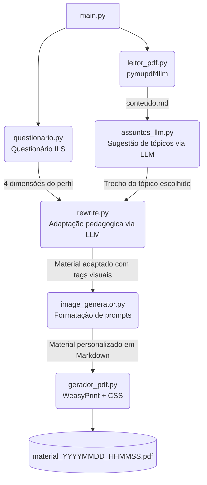

# Sistema de Personalização de Materiais Didáticos

Sistema acadêmico desenvolvido no âmbito do **Mestrado em Ciência da Computação — UFMA**, cujo objetivo é adaptar automaticamente materiais didáticos em PDF ao perfil cognitivo de cada estudante, com base no modelo de estilos de aprendizagem de **Felder-Silverman (ILS)** integrado à **API Gemini (Google AI)**.

---

## Status: Fases 0–8 concluídas (API + Worker + exposição do resultado) — protótipo legado mantido intacto

O protótipo descrito mais abaixo (`main.py` + `modulos/`) continua funcional e é mantido intacto. A arquitetura definitiva (FastAPI + Worker + Pipeline, Clean Architecture), implementada em `src/`, já cobre de ponta a ponta o cadastro de Aluno, Material Didático e Perfil de Aprendizagem, o Processamento de Personalização (criação síncrona via API + execução assíncrona via Worker, com retry nativo do SDK Gemini) e a exposição do resultado — Material Personalizado (com URL assinada de leitura), Log de Interação e Acesso ao Material Personalizado. Fases 9–12 do plano (hardening de segurança adicional, observabilidade, deploy, integração piloto com o plugin Moodle) ainda não foram iniciadas.

A implementação segue rigorosamente:

- [`documentacao/Documento_2_Modelagem_Sistema_v2.docx`](documentacao/Documento_2_Modelagem_Sistema_v2.docx) — modelagem do sistema (DER, casos de uso).
- [`documentacao/Documento_3_Especificacao_API_v2.docx`](documentacao/Documento_3_Especificacao_API_v2.docx) — contrato REST completo.
- [`documentacao/Documento_4_Arquitetura_Tecnica.docx`](documentacao/Documento_4_Arquitetura_Tecnica.docx) — arquitetura técnica da implementação.
- [`documentacao/Documento_5_Plano_Implementacao.docx`](documentacao/Documento_5_Plano_Implementacao.docx) — ordem de módulos, padrões de código e roadmap.
- [`DIRETRIZES_DESENVOLVIMENTO_SEGURANCA.md`](DIRETRIZES_DESENVOLVIMENTO_SEGURANCA.md) — diretriz obrigatória de segurança/SSDLC.

Esses cinco documentos são a única fonte de verdade da nova arquitetura; qualquer código em `src/` deve estar em conformidade com eles.

---

## Arquitetura Atual (`src/`) — API + Worker

Clean Architecture em camadas, com regra de dependência de mão única (`presentation`/`worker` → `infrastructure` → `application` → `domain`; `application` nunca importa `infrastructure`, `presentation` ou SQLAlchemy):

```text
src/
├── domain/            # Entidades e regras de negócio puras (sem I/O)
│   ├── aluno/ material/ perfil/ processamento/ material_personalizado/
│   └── shared/         # DomainError e exceções base
├── application/        # Casos de uso + portas (interfaces) que a Infrastructure implementa
│   ├── aluno/ material/ perfil/ processamento/
│   └── ports/           # IAlunoRepository, IObjectStoragePort, ILLMPort, IQueuePort, ...
├── infrastructure/      # Implementações concretas
│   ├── database/         # Repositórios SQLAlchemy (um por agregado) + engine/sessão
│   ├── storage/           # SupabaseStorageAdapter (Object Storage do Material Didático)
│   ├── llm/                # GeminiAdapter (perfil + reescrita pedagógica)
│   ├── pipeline/            # extrator, normalizador, resumo, gerador_pdf (Fase 7)
│   ├── queue/                # FilaPostgres (fila_processamento, SKIP LOCKED)
│   └── config/                # Settings (pydantic-settings)
├── presentation/api/    # FastAPI: routers, schemas, autenticação, middleware
├── worker/              # Processo assíncrono consumidor da fila (Fase 7)
└── core/                # Composição (get_settings, logging, exception handlers)
```

### Módulos implementados

- **Aluno** — cadastro/consulta/atualização (`POST/GET/PUT /api/v1/alunos`).
- **Material Didático** — upload de PDF para o Object Storage, versionamento, listagem (`POST/GET /api/v1/materiais`).
- **Perfil de Aprendizagem** — cadastro do perfil Felder-Silverman (4 dimensões) com descrição gerada via Gemini (`POST /api/v1/alunos/{aluno_id}/perfil`, `GET .../perfil`, `GET .../perfis`).
- **Processamento de Personalização** — orquestra a personalização de um Material para um Aluno:
  1. `POST /api/v1/processamentos` cria o `Processamento` (status `pendente`) e publica uma mensagem na fila `fila_processamento`, na mesma transação.
  2. O **Worker** (processo separado, `src/worker/`) reivindica a mensagem mais antiga com `SELECT ... FOR UPDATE SKIP LOCKED` (concorrência segura entre múltiplas instâncias), marca o `Processamento` como `em_processamento` e executa o **Pipeline de PDF**:
     extração do PDF original em Markdown (`pymupdf4llm`) → reescrita pedagógica via Gemini, adaptada às 4 dimensões do Perfil → normalização de LaTeX/Markdown → geração do resumo → renderização do Markdown final em PDF (`WeasyPrint`, com carregamento de rede externo desabilitado por padrão — mitigação de SSRF) → upload do PDF ao Object Storage → persistência do `MaterialPersonalizado` e conclusão do `Processamento`, tudo na mesma transação da remoção da mensagem da fila.
  3. Chamadas ao Gemini (tanto a reescrita pedagógica quanto a `descricao_llm` síncrona do Perfil) usam o retry nativo do SDK `google-genai` (`HttpRetryOptions`: tentativas, backoff exponencial e jitter configuráveis via `Settings`/`.env`) — não um loop manual. O orçamento total de uma chamada do Worker (que não bloqueia nenhuma requisição HTTP) é maior que o do caminho síncrono do Perfil, que mantém o tempo-limite curto exigido pelo Documento 3 §4.2.
  4. Falhas em qualquer etapa (inclusive esgotar as tentativas de retry do Gemini) marcam o `Processamento` como `erro` (mensagem genérica, sem detalhes internos) sem derrubar o Worker; um `Processamento` preso em `em_processamento` por tempo maior que `WORKER_IDADE_MAXIMA_PRESOS_SEGUNDOS` é devolvido para `pendente` automaticamente, tanto na inicialização quanto periodicamente durante o loop do Worker.
  5. Consulta e listagem: `GET /api/v1/processamentos/{id}`, `GET /api/v1/alunos/{aluno_id}/processamentos`.
  6. `erro` e `concluido` são estados terminais do `Processamento` (Documento 3 §14) — não há reprocessamento do mesmo registro. Uma nova tentativa do aluno é sempre um novo `POST /api/v1/processamentos`, criando um novo `Processamento`.
- **Material Personalizado, Log de Interação e Acesso** — expõem o resultado do Processamento e o histórico de uso:
  - `GET /api/v1/processamentos/{id}/material` e `GET /api/v1/materiais-personalizados/{id}` devolvem o `MaterialPersonalizado`, com `caminho_pdf` sempre como uma URL assinada e temporária (nunca a chave bruta do Object Storage — Documento 3 §7).
  - `POST /api/v1/logs` e `GET /api/v1/processamentos/{id}/logs` registram e consultam eventos de interação.
  - `GET/PUT /api/v1/materiais-personalizados/{id}/acesso` registra e consulta o progresso de leitura de um Aluno sobre um Material Personalizado, com checagem de posse (o `aluno_id` do corpo precisa corresponder ao aluno do `Processamento` de origem — proteção contra IDOR/BOLA).

### Autenticação

Todas as rotas de negócio (exceto `GET /health`) exigem `Authorization: Bearer <SERVICE_TOKEN>` — um único token estático por instalação, comparado em tempo constante (`hmac.compare_digest`). Não há JWT, OAuth ou sessão por aluno nesta versão.

---

## Executando a Arquitetura Atual (`src/`)

### Pré-requisitos

- Python 3.13+ (o projeto declara `requires-python = ">=3.13"` em `pyproject.toml`; usar uma versão menor causa erros de import como `datetime.UTC`/`enum.StrEnum`).
- [`uv`](https://docs.astral.sh/uv/) para gerência de dependências.
- Docker (para o Postgres via `docker-compose.yml`) — ou um Postgres 16 acessível por outro meio.
- Bibliotecas nativas do WeasyPrint (Pango, Cairo, GObject) — necessárias para o Worker gerar PDF. No macOS: `brew install pango cairo libffi`. No Debian/Ubuntu: `apt-get install libpango-1.0-0 libpangocairo-1.0-0 libcairo2`. **No Windows**, o pacote Python não traz essas bibliotecas — sem elas, qualquer import de `weasyprint` falha com `OSError: cannot load library 'libgobject-2.0-0'`. Instale o runtime GTK3 para Windows (ex.: [instalador da GNOME/msys2 linkado na documentação oficial do WeasyPrint](https://doc.courtbouillon.org/weasyprint/stable/first_steps.html#windows)) e garanta que a pasta `bin` da instalação esteja no `PATH` do usuário antes de abrir um novo terminal — o WeasyPrint carrega essas DLLs em tempo de execução, não em tempo de instalação do pacote Python.
- Uma chave de API do Gemini e um projeto Supabase (Storage) — ver `.env.example`.

### Instalação e configuração

```bash
uv sync --all-groups     # instala dependências de runtime e desenvolvimento

cp .env.example .env     # preencha SERVICE_TOKEN, STORAGE_URL, STORAGE_SERVICE_KEY, GEMINI_API_KEY
```

### Banco de dados

```bash
docker compose up -d postgres         # sobe o Postgres 16 na porta 5433 (ver POSTGRES_PORT no .env)
uv run alembic upgrade head           # aplica as migrations (requer DATABASE_URL válido no .env)
```

### Backup e Restore do PostgreSQL

Critério de conclusão da Fase 11 (Documento 5, §185). Procedimento manual e testado — não é um backup agendado automaticamente.

```bash
scripts/backup_postgres.sh                  # gera backups/<POSTGRES_DB>_<timestamp>.dump
scripts/restore_postgres.sh backups/arquivo.dump   # restaura (pede confirmação: destrutivo)
```

`pg_dump`/`pg_restore` rodam dentro do container `postgres` via `docker compose exec` (não exigem cliente Postgres no host) e autenticam com `POSTGRES_USER`/`POSTGRES_PASSWORD` do `.env` — a senha nunca aparece em `ps aux`, em log ou em arquivo. `restore_postgres.sh` usa `--clean --if-exists`: derruba e recria os objetos existentes do banco alvo antes de restaurar, por isso pede para digitar o nome do banco como confirmação. Dumps ficam em `backups/`, ignorado pelo Git (contêm dados reais).

### Roles do PostgreSQL

Privilégio mínimo (Fase 11, Documento 4 §13.2): duas roles, responsabilidades separadas.

- **`POSTGRES_USER`** (admin) — usuário administrativo do cluster. Usado por Alembic (migrations), pelos scripts de backup/restore, e para manutenção manual. Nunca usado pela API ou pelo Worker.
- **`mpi_app`** (runtime) — sem `SUPERUSER`, `CREATEDB` ou `CREATEROLE`. Só `SELECT`/`INSERT`/`UPDATE`/`DELETE` nas tabelas da aplicação, sem privilégio de criar/apagar tabelas. É a única credencial que API e Worker usam dentro do Docker Compose.

Em um ambiente novo (ou depois de definir `POSTGRES_APP_PASSWORD` no `.env` pela primeira vez), crie a role de runtime com:

```bash
python scripts/setup_postgres_app_role.py
```

Idempotente — seguro rodar de novo (ex.: rotação de senha). Não exige Bash/WSL: funciona igual em PowerShell, cmd ou shell Unix, contanto que o Postgres do `docker-compose.yml` já esteja em execução.

### Iniciar a API

```bash
uv run uvicorn presentation.api.main:app --app-dir src --reload
```

A API sobe em `http://localhost:8000`; `GET /health` não exige autenticação.

### Iniciar o Worker

Processo separado da API, sem servidor HTTP — consome `fila_processamento` em loop contínuo até ser interrompido:

```bash
PYTHONPATH=src uv run python -m worker.worker
```

### Executar os testes

```bash
uv run pytest                                  # suíte completa (unit + integration + api)
uv run ruff check src tests migrations         # lint
uv run ruff format --check src tests migrations # formatação
uv run mypy src migrations                     # checagem de tipos
```

Os testes de integração e de API exigem um Postgres real acessível na `DATABASE_URL` configurada para testes (ver `tests/conftest.py`); os de unidade não dependem de banco.

### Teste de carga e concorrência

Ferramental separado da suíte pytest, para o critério de conclusão da Fase 10 (Documento 5, §17) — ver [`loadtest/README.md`](loadtest/README.md).

---

## 📂 Protótipo Legado (`main.py` + `modulos/`) — Arquitetura

> As seções abaixo descrevem o protótipo original (script único, sem API/Worker), mantido intacto e funcional em paralelo à arquitetura atual descrita acima.

```text
projeto_bkb/
├── main.py                          # Orquestrador do pipeline completo
├── .env                             # Variáveis de ambiente (API keys) — não versionar
├── disciplina.pdf                   # Material base em PDF — fornecido pelo usuário
└── modulos/
    ├── aluno/
    │   └── questionario.py          # Questionário ILS e mapeamento de dimensões
    ├── llm/
    │   ├── gemini_config.py         # Configuração da SDK Gemini com retry automático
    │   ├── assuntos_llm.py          # Identifica e extrai o tópico escolhido via LLM
    │   └── rewrite.py               # Adapta o conteúdo ao perfil do aluno via LLM
    └── pdf/
        ├── leitor_pdf.py            # Converte PDF → Markdown (pymupdf4llm)
        └── gerador_pdf.py           # Renderiza Markdown → PDF (WeasyPrint + CSS GitHub)
```

---

## Como Funciona o Protótipo Legado

Ao executar `python main.py`, o pipeline percorre 5 etapas em sequência:

### 1. Questionário de Perfil (`modulos/aluno/questionario.py`)
O aluno responde 4 perguntas do **Index of Learning Styles (ILS)**, que mapeiam as dimensões do modelo de Felder-Silverman:

| Dimensão | Opção A | Opção B |
|---|---|---|
| Compreensão | Sequencial | Global |
| Percepção | Sensorial | Intuitivo |
| Entrada | Visual | Verbal |
| Processamento | Ativo | Reflexivo |

### 2. Leitura do PDF (`modulos/pdf/leitor_pdf.py`)
O arquivo `disciplina.pdf` é processado via `pymupdf4llm`, convertendo todo o conteúdo textual para formato Markdown (`.md`). Imagens do PDF original não são embutidas — o foco é a fidelidade do texto para uso com LLMs.

### 3. Identificação do Tópico (`modulos/llm/assuntos_llm.py`)
Uma amostra do Markdown gerado é enviada ao Gemini, que sugere de 3 a 8 tópicos principais da disciplina. O aluno escolhe o tópico desejado (ou digita um tema livre). O sistema então extrai o trecho relevante do conteúdo usando as palavras-chave do tópico.

### 4. Adaptação Pedagógica (`modulos/llm/rewrite.py`)
O trecho do tópico e o perfil do aluno são enviados ao Gemini com um prompt estruturado segundo as diretrizes do ILS:
- **Sensorial/Intuitivo** → ênfase em exemplos práticos ou teoria conceitual
- **Visual/Verbal** → tags para representações visuais ou explicações narrativas detalhadas
- **Ativo/Reflexivo** → desafios práticos imediatos, ou perguntas instigantes para reflexão
- **Sequencial/Global** → trilha linear passo a passo, ou visão macro antes dos detalhes

### 5. Geração de Prompts Visuais (`modulos/llm/image_generator.py`)
Para alunos com perfil **Visual**, a IA gera blocos no formato `[SUGESTAO_IMAGEM: <prompt>]`. O módulo de imagens identifica essas ocorrências e formata um bloco de citação (Blockquote) Markdown. Esses prompts ficam visíveis no texto final para que o usuário possa gerar manualmente as imagens em ferramentas externas (como Midjourney ou DALL-E) com precisão.

### 6. Geração do PDF (`modulos/pdf/gerador_pdf.py`)
O material adaptado em Markdown é salvo na raiz e convertido para PDF via **WeasyPrint**, com tema visual inspirado no estilo do GitHub (tipografia limpa, tabelas, blocos de código e cabeçalho com o perfil do aluno).

---

## Fluxograma



---

## Como Executar o Protótipo Legado

### Pré-requisitos

- Python 3.10+
- [Homebrew](https://brew.sh/) com Pango e Cairo instalados (necessário para WeasyPrint no macOS):

```bash
brew install pango cairo libffi
```

### Instalação

```bash
# Clone o repositório
git clone <url-do-repositorio>
cd projeto_bkb

# Crie e ative o ambiente virtual
python -m venv .venv
source .venv/bin/activate

# Instale as dependências
pip install pymupdf4llm google-generativeai python-dotenv markdown weasyprint
```

### Configuração

Crie um arquivo `.env` na raiz do projeto com sua chave da API Gemini:

```env
GEMINI_API_KEY=sua_chave_aqui
```

> Obtenha sua chave em: [https://aistudio.google.com/app/apikey](https://aistudio.google.com/app/apikey)

### Uso

1. Coloque o material da disciplina em PDF na raiz com o nome `disciplina.pdf`
2. Execute o programa:

```bash
python main.py
```

3. Siga as instruções no terminal: responda o questionário, escolha o tópico e aguarde a geração do PDF personalizado em `materiais_gerados/`.

---

## Referências

- Felder, R. M., & Silverman, L. K. (1988). *Learning and Teaching Styles in Engineering Education*.
- Troussas, C. et al. (2020). *Adaptive Learning Rate Based on Entropy*. Entropy, MDPI.
- Vaccaro, M. et al. (2025). *LLM-based Adaptive Content Generation*.
- [pymupdf4llm](https://github.com/pymupdf/RAG) — Extração de PDF otimizada para LLMs
- [WeasyPrint](https://weasyprint.org/) — Renderização HTML/CSS para PDF

---

## ⚠️ Observações e Envio ao GitHub

- O arquivo `.env` **não deve ser versionado**. Para evitar vazamento de chaves de API, certifique-se de ter um arquivo `.gitignore` no projeto. O projeto foi atualizado com um arquivo pronto.
- Os arquivos `.pdf` de origem e os conteúdos em `materiais_gerados/` e os arquivos temporários `.md` também são bloqueados pelo `.gitignore` para não lotar seu repositório.
- O modelo Gemini é selecionado dinamicamente com base nos modelos disponíveis para a API key informada.
