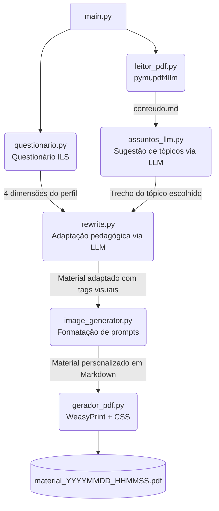

# Sistema de Personalização de Materiais Didáticos

Sistema acadêmico desenvolvido no âmbito do **Mestrado em Ciência da Computação — UFMA**, cujo objetivo é adaptar automaticamente materiais didáticos em PDF ao perfil cognitivo de cada estudante, com base no modelo de estilos de aprendizagem de **Felder-Silverman (ILS)** integrado à **API Gemini (Google AI)**.

---

## Status: Fases 0–8 concluídas (API + Worker + exposição do resultado) — protótipo legado mantido intacto

O protótipo descrito mais abaixo (`main.py` + `modulos/`) continua funcional e é mantido intacto. A arquitetura definitiva (FastAPI + Worker + Pipeline, Clean Architecture), implementada em `src/`, já cobre de ponta a ponta o cadastro de Aluno, Material Didático e Perfil de Aprendizagem, o Processamento de Personalização (criação síncrona via API + execução assíncrona via Worker, com retry nativo do SDK Gemini) e a exposição do resultado — Material Personalizado (com URL assinada de leitura), Log de Interação e Acesso ao Material Personalizado. Fases 9–12 do plano (hardening de segurança adicional, observabilidade, deploy, integração piloto com o plugin Moodle) ainda não foram iniciadas.

A implementação segue rigorosamente:

- [`documentacao/Documento_2_Modelagem_Sistema_v2.docx`](documentacao/Documento_2_Modelagem_Sistema_v2.docx) — modelagem do sistema (DER, casos de uso).
- [`documentacao/Documento_3_Especificacao_API_v2.docx`](documentacao/Documento_3_Especificacao_API_v2.docx) — contrato REST completo.
- [`documentacao/Documento_4_Arquitetura_Tecnica.docx`](documentacao/Documento_4_Arquitetura_Tecnica.docx) — arquitetura técnica da implementação.
- [`documentacao/Documento_5_Plano_Implementacao.docx`](documentacao/Documento_5_Plano_Implementacao.docx) — ordem de módulos, padrões de código e roadmap.
- [`DIRETRIZES_DESENVOLVIMENTO_SEGURANCA.md`](DIRETRIZES_DESENVOLVIMENTO_SEGURANCA.md) — diretriz obrigatória de segurança/SSDLC.

Esses cinco documentos são a única fonte de verdade da nova arquitetura; qualquer código em `src/` deve estar em conformidade com eles.

---

## Arquitetura Atual (`src/`) — API + Worker

Clean Architecture em camadas, com regra de dependência de mão única (`presentation`/`worker` → `infrastructure` → `application` → `domain`; `application` nunca importa `infrastructure`, `presentation` ou SQLAlchemy):

```text
src/
├── domain/            # Entidades e regras de negócio puras (sem I/O)
│   ├── aluno/ material/ perfil/ processamento/ material_personalizado/
│   └── shared/         # DomainError e exceções base
├── application/        # Casos de uso + portas (interfaces) que a Infrastructure implementa
│   ├── aluno/ material/ perfil/ processamento/
│   └── ports/           # IAlunoRepository, IObjectStoragePort, ILLMPort, IQueuePort, ...
├── infrastructure/      # Implementações concretas
│   ├── database/         # Repositórios SQLAlchemy (um por agregado) + engine/sessão
│   ├── storage/           # SupabaseStorageAdapter (Object Storage do Material Didático)
│   ├── llm/                # GeminiAdapter (perfil + reescrita pedagógica)
│   ├── pipeline/            # extrator, normalizador, resumo, gerador_pdf (Fase 7)
│   ├── queue/                # FilaPostgres (fila_processamento, SKIP LOCKED)
│   └── config/                # Settings (pydantic-settings)
├── presentation/api/    # FastAPI: routers, schemas, autenticação, middleware
├── worker/              # Processo assíncrono consumidor da fila (Fase 7)
└── core/                # Composição (get_settings, logging, exception handlers)
```

### Módulos implementados

- **Aluno** — cadastro/consulta/atualização (`POST/GET/PUT /api/v1/alunos`).
- **Material Didático** — upload de PDF para o Object Storage, versionamento, listagem (`POST/GET /api/v1/materiais`).
- **Perfil de Aprendizagem** — cadastro do perfil Felder-Silverman (4 dimensões) com descrição gerada via Gemini (`POST /api/v1/alunos/{aluno_id}/perfil`, `GET .../perfil`, `GET .../perfis`).
- **Processamento de Personalização** — orquestra a personalização de um Material para um Aluno:
  1. `POST /api/v1/processamentos` cria o `Processamento` (status `pendente`) e publica uma mensagem na fila `fila_processamento`, na mesma transação.
  2. O **Worker** (processo separado, `src/worker/`) reivindica a mensagem mais antiga com `SELECT ... FOR UPDATE SKIP LOCKED` (concorrência segura entre múltiplas instâncias), marca o `Processamento` como `em_processamento` e executa o **Pipeline de PDF**:
     extração do PDF original em Markdown (`pymupdf4llm`) → reescrita pedagógica via Gemini, adaptada às 4 dimensões do Perfil → normalização de LaTeX/Markdown → geração do resumo → renderização do Markdown final em PDF (`WeasyPrint`, com carregamento de rede externo desabilitado por padrão — mitigação de SSRF) → upload do PDF ao Object Storage → persistência do `MaterialPersonalizado` e conclusão do `Processamento`, tudo na mesma transação da remoção da mensagem da fila.
  3. Chamadas ao Gemini (tanto a reescrita pedagógica quanto a `descricao_llm` síncrona do Perfil) usam o retry nativo do SDK `google-genai` (`HttpRetryOptions`: tentativas, backoff exponencial e jitter configuráveis via `Settings`/`.env`) — não um loop manual. O orçamento total de uma chamada do Worker (que não bloqueia nenhuma requisição HTTP) é maior que o do caminho síncrono do Perfil, que mantém o tempo-limite curto exigido pelo Documento 3 §4.2.
  4. Falhas em qualquer etapa (inclusive esgotar as tentativas de retry do Gemini) marcam o `Processamento` como `erro` (mensagem genérica, sem detalhes internos) sem derrubar o Worker; um `Processamento` preso em `em_processamento` por tempo maior que `WORKER_IDADE_MAXIMA_PRESOS_SEGUNDOS` é devolvido para `pendente` automaticamente, tanto na inicialização quanto periodicamente durante o loop do Worker.
  5. Consulta e listagem: `GET /api/v1/processamentos/{id}`, `GET /api/v1/alunos/{aluno_id}/processamentos`.
  6. `erro` e `concluido` são estados terminais do `Processamento` (Documento 3 §14) — não há reprocessamento do mesmo registro. Uma nova tentativa do aluno é sempre um novo `POST /api/v1/processamentos`, criando um novo `Processamento`.
- **Material Personalizado, Log de Interação e Acesso** — expõem o resultado do Processamento e o histórico de uso:
  - `GET /api/v1/processamentos/{id}/material` e `GET /api/v1/materiais-personalizados/{id}` devolvem o `MaterialPersonalizado`, com `caminho_pdf` sempre como uma URL assinada e temporária (nunca a chave bruta do Object Storage — Documento 3 §7).
  - `POST /api/v1/logs` e `GET /api/v1/processamentos/{id}/logs` registram e consultam eventos de interação.
  - `GET/PUT /api/v1/materiais-personalizados/{id}/acesso` registra e consulta o progresso de leitura de um Aluno sobre um Material Personalizado, com checagem de posse (o `aluno_id` do corpo precisa corresponder ao aluno do `Processamento` de origem — proteção contra IDOR/BOLA).

### Autenticação

Todas as rotas de negócio (exceto `GET /health`) exigem `Authorization: Bearer <SERVICE_TOKEN>` — um único token estático por instalação, comparado em tempo constante (`hmac.compare_digest`). Não há JWT, OAuth ou sessão por aluno nesta versão.

### Segurança (resumo)

- **Autenticação antes do corpo:** para `/api/*`, um middleware (`presentation/api/protecao_corpo.py`) valida o token e limita o corpo **antes** de qualquer parse: sem token válido a resposta é 401 sem ler o corpo; corpo acima do limite (com ou sem `Content-Length`) responde 413 (`CORPO_MUITO_GRANDE`). Limites: `MATERIAL_TAMANHO_MAXIMO_BYTES` (+256 KiB de multipart) no upload e `CORPO_JSON_TAMANHO_MAXIMO_BYTES` (1 MiB) nas demais rotas. `/health`, `/ready` e preflights `OPTIONS` ficam de fora. Não substitui o limite de corpo e de tempo do proxy reverso, que continua necessário.
- **Limites de PDF:** `PDF_PAGINAS_MAXIMAS` (padrão 100; recusado no upload com 400 `PDF_PAGINAS_EXCEDIDAS` e de novo no pipeline) e `PDF_PIXELS_MAXIMOS_POR_IMAGEM` (padrão 25 milhões; imagens maiores são descartadas). O `docker-compose.yml` define `mem_limit`, `cpus` e `pids_limit` para `api` e `worker` (`API_MEM_LIMIT`, `API_CPUS`, `WORKER_MEM_LIMIT`, `WORKER_CPUS`).
- **Worker:** prazo máximo por job (`WORKER_PRAZO_MAXIMO_JOB_SEGUNDOS`, padrão 420 s, sempre menor que `WORKER_IDADE_MAXIMA_PRESOS_SEGUNDOS`), gravação do resultado só se o Worker ainda for o dono da execução (`UPDATE` condicional por status e `inicio`) e contador `processamento.tentativas` (migration `b7c1e2f94a3d`): após `WORKER_TENTATIVAS_MAXIMAS` (padrão 3) reivindicações, um job preso termina em `erro` em vez de voltar à fila para sempre.
- **Falhas transitórias do Gemini (503, 429, timeout total):** depois de esgotadas as repetições internas do SDK, o `GeminiAdapter` levanta `FalhaTransitoriaDoProvedorError` (só para a chamada ao modelo; extração, montagem do PDF, credenciais, resposta vazia e Storage continuam encerrando em `erro`). O caso de uso devolve o job a `pendente`, de forma condicional à posse (`inicio`) e a `tentativas < WORKER_TENTATIVAS_MAXIMAS`, com espera persistida em `processamento.disponivel_em` (migration `c3d8f1a07b52`): `WORKER_REPETICAO_ATRASO_BASE_SEGUNDOS` (30 s) × 2^(n−1), teto `WORKER_REPETICAO_ATRASO_MAXIMO_SEGUNDOS` (300 s), com jitter que só reduz a espera. A mensagem da fila é preservada enquanto o job está `pendente`; o erro exposto pela API continua genérico, e a causa (categoria e código HTTP, sem corpo nem cabeçalhos) fica só no log. Com os padrões, o pior caso de espera é 90 s, e cada reivindicação segue limitada pelo prazo de `WORKER_PRAZO_MAXIMO_JOB_SEGUNDOS`; a espera acontece em `pendente`, fora do alcance da recuperação de presos.
- **Limites das etapas locais do pipeline:** a extração do PDF original (texto e imagens) e a montagem do PDF final são trabalho de CPU, sem rede, e têm limites próprios, separados do timeout do Gemini (`GEMINI_TIMEOUT_SEGUNDOS`, 5 s por tentativa; `GEMINI_TIMEOUT_TOTAL_SEGUNDOS`, 45 s no total): `PIPELINE_TIMEOUT_EXTRACAO_SEGUNDOS` (padrão 30 s; vale para a extração do texto e, só com `PDF_ANEXAR_IMAGENS_ORIGINAIS=true`, também para a das imagens originais; PDFs de dezenas de páginas e muitas imagens levaram 41–54 s no contêiner e pedem cerca de 90 s) e `PIPELINE_TIMEOUT_PDF_SEGUNDOS` (padrão 60 s). Estourar a extração do texto ou a montagem do PDF encerra o job em `erro`, sem devolvê-lo à fila (não é falha transitória do provedor, então não repete a chamada paga); estourar só a extração das imagens originais apenas as omite. **Recuperação com imagens geradas ligadas:** se a imagem foi gerada mas a montagem do PDF com ela falha ou estoura o limite, o Worker refaz o PDF só com o texto já adaptado (sem marcadores nem âncoras de imagem), sem nova chamada ao Gemini nem ao provedor de imagens; se essa segunda montagem também falhar, o job termina em `erro` como antes. **Relação com o prazo do job:** a soma dos tempos máximos de espera de uma execução (extração do texto [× 2 se as imagens originais forem anexadas] + `GEMINI_TIMEOUT_TOTAL_SEGUNDOS` × (1 + complementações) + montagem do PDF; com imagens ligadas, soma-se `IMAGENS_ORCAMENTO_TOTAL_SEGUNDOS` e uma segunda montagem do PDF) precisa caber em `WORKER_PRAZO_MAXIMO_JOB_SEGUNDOS` (padrão 420 s); com os padrões são 135 s (imagens desligadas) e 345 s (ligadas), sem contar a complementação, e uma configuração que passe do prazo é recusada na inicialização do Worker. Essa conta confere a coerência da configuração: ela **não** inclui o download e o upload no Storage nem o banco (a folga com imagens ligadas é para eles), e o teto real de um job é o próprio `WORKER_PRAZO_MAXIMO_JOB_SEGUNDOS`, aplicado com `asyncio.wait_for`; o prazo conta por execução (reivindicação), não inclui a espera entre tentativas. **Limite conhecido:** estourar o limite de uma etapa local encerra só a *espera*; a thread de extração ou de montagem do PDF não pode ser interrompida em Python e segue até terminar, inclusive em paralelo com a montagem de recuperação sem imagens. A contenção é a do contêiner (`WORKER_MEM_LIMIT`, `WORKER_CPUS`, `pids_limit`, `restart: unless-stopped`) e a recuperação de jobs presos; o aviso no log indica quando isso ocorre.
- **Ilustrações e imagens originais:** com `IMAGENS_GERADAS_HABILITADAS=true`, o Gemini marca no texto (logo depois do parágrafo que explica o conceito) até `IMAGENS_MAX_POR_MATERIAL` ilustrações; cada uma é gerada pelo provedor configurado e inserida no PDF como figura com legenda numerada, junto ao seu tópico (tamanho contido, sem página só de imagem). As imagens do PDF de origem **não** são extraídas nem anexadas por padrão (a antiga seção "Imagens do material original" saiu); `PDF_ANEXAR_IMAGENS_ORIGINAIS=true` as devolve ao final do documento. Se a geração falhar ou nenhuma ilustração for marcada, o PDF sai só com texto e o log registra o motivo; as imagens geradas não são guardadas à parte, só dentro do PDF.
- **Qualidade e profundidade da reescrita:** a instrução enviada ao Gemini pede um material de estudo completo (não um resumo), com exemplos resolvidos, aplicações, erros frequentes e exercícios comentados quando pertinentes, e explica como adaptar cada dimensão Felder-Silverman; a extensão acompanha o conteúdo, sem meta fixa de palavras. A resposta é considerada insuficiente (heurísticas locais em `infrastructure/llm/qualidade_reescrita.py`, sem outro modelo) se vier incompleta (status `incomplete`), abaixo de `GEMINI_REESCRITA_PROPORCAO_MINIMA` (padrão 0,8) do tamanho do original, se perder mais de 40% dos conceitos essenciais do original (títulos, termos em negrito e palavras longas frequentes) ou, em originais com 2.000 caracteres ou mais, se tiver menos de 2 dos 3 elementos pedagógicos (exemplos, prática, erros comuns); originais com menos de 600 caracteres não são avaliados. Nesses casos o Worker faz até `GEMINI_REESCRITA_COMPLEMENTO_TENTATIVAS` chamadas extras (padrão 1; 0 desliga) e fica com a maior resposta; falha na chamada extra mantém a resposta anterior. Cada chamada extra entra na soma dos limites de `WORKER_PRAZO_MAXIMO_JOB_SEGUNDOS`. **Limitação:** essas heurísticas não verificam fidelidade semântica (se o conteúdo está correto ou se os exemplos fazem sentido); isso exigiria outro modelo ou revisão humana e não foi implementado.
- **Contêineres:** `api` e `worker` não usam mais `env_file: .env`; recebem só as variáveis listadas no `docker-compose.yml`. A senha do superusuário do PostgreSQL (`POSTGRES_USER`/`POSTGRES_PASSWORD`) e as credenciais da Cloudflare (só o Worker) não chegam à API.
- **Documentação interativa:** `/docs`, `/redoc` e `/openapi.json` só existem com `ENVIRONMENT=development`.
- **Validação de entrada:** nome, e-mail e matrícula têm os mesmos limites das colunas; `acao` (100) e `descricao` (2000) do log; `tempo_leitura_incremento_segundos` entre 0 e 86 400; título do material até 255 caracteres; o nome de arquivo enviado é reduzido ao nome base. O `resumo` devolvido pela API é texto puro (marcação HTML removida).
- **Taxa de requisições:** `POST /processamentos`, `POST /materiais` e `POST /alunos/{id}/perfil` (esta chama o Gemini de forma síncrona; `RATE_LIMIT_PERFIS_POR_MINUTO`, padrão 20).
- **Contrato de `POST /alunos` (mudança):** para uma matrícula já cadastrada a resposta é `200` com **somente** `id` e `grupo_experimental`; nome e e-mail só saem em `GET /api/v1/alunos/{id}`. O cadastro novo (`201`) continua devolvendo o registro completo. A autorização por aluno continua sendo responsabilidade do plugin do Moodle: a API confia no token de serviço (ver Autenticação), então o token precisa trafegar só por TLS, ficar apenas no servidor do plugin e ser rotacionado.

---

## Executando a Arquitetura Atual (`src/`)

### Pré-requisitos

- Python 3.13+ (o projeto declara `requires-python = ">=3.13"` em `pyproject.toml`; usar uma versão menor causa erros de import como `datetime.UTC`/`enum.StrEnum`).
- [`uv`](https://docs.astral.sh/uv/) para gerência de dependências.
- Docker (para o Postgres via `docker-compose.yml`) — ou um Postgres 16 acessível por outro meio.
- Bibliotecas nativas do WeasyPrint (Pango, Cairo, GObject) — necessárias para o Worker gerar PDF. No macOS: `brew install pango cairo libffi`. No Debian/Ubuntu: `apt-get install libpango-1.0-0 libpangocairo-1.0-0 libcairo2`. **No Windows**, o pacote Python não traz essas bibliotecas — sem elas, qualquer import de `weasyprint` falha com `OSError: cannot load library 'libgobject-2.0-0'`. Instale o runtime GTK3 para Windows (ex.: [instalador da GNOME/msys2 linkado na documentação oficial do WeasyPrint](https://doc.courtbouillon.org/weasyprint/stable/first_steps.html#windows)) e garanta que a pasta `bin` da instalação esteja no `PATH` do usuário antes de abrir um novo terminal — o WeasyPrint carrega essas DLLs em tempo de execução, não em tempo de instalação do pacote Python.
- Uma chave de API do Gemini e um projeto Supabase (Storage) — ver `.env.example`.

### Instalação e configuração

```bash
uv sync --all-groups     # instala dependências de runtime e desenvolvimento

cp .env.example .env     # preencha SERVICE_TOKEN, STORAGE_URL, STORAGE_SERVICE_KEY, GEMINI_API_KEY
```

### Banco de dados

```bash
docker compose up -d postgres         # sobe o Postgres 16 na porta 5433 (ver POSTGRES_PORT no .env)
uv run alembic upgrade head           # aplica as migrations (requer DATABASE_URL válido no .env)
```

**Migrations rodam no host, nunca dentro dos contêineres.** As imagens `api` e `worker` copiam só `src/`: não têm `alembic.ini` nem `migrations/`, e o contêiner da API só conhece a role `mpi_app`, sem permissão de DDL. Por isso `docker compose exec api alembic ...` falha com `No 'script_location' key found` (comportamento esperado). Use `uv run alembic ...` no host, que conecta em `localhost:${POSTGRES_PORT}` com `POSTGRES_USER`.

Cuidado: uma variável `DATABASE_URL` definida na sessão do shell **vence o `.env`** (precedência do pydantic-settings) e redireciona o Alembic para outro banco (por exemplo `mpi_test`), que passa a mostrar uma revisão diferente da do `mpi`. Antes de qualquer `upgrade`, rode as migrations ignorando a variável da sessão (PowerShell):

```powershell
& { $s = $env:DATABASE_URL; Remove-Item Env:\DATABASE_URL -ErrorAction SilentlyContinue
    try { uv run --no-sync alembic current; uv run --no-sync alembic heads } finally { if ($null -ne $s) { $env:DATABASE_URL = $s } } }
```

Como as imagens embutem o código (`COPY src/`, sem bind mount), toda mudança em `src/` exige `docker compose build api worker` e recriação dos contêineres; aplique a migration **antes** de subir o código novo.

### Backup e Restore do PostgreSQL

Critério de conclusão da Fase 11 (Documento 5, §185). Procedimento manual e testado — não é um backup agendado automaticamente.

```bash
scripts/backup_postgres.sh                  # gera backups/<POSTGRES_DB>_<timestamp>.dump
scripts/restore_postgres.sh backups/arquivo.dump   # restaura (pede confirmação: destrutivo)
```

`pg_dump`/`pg_restore` rodam dentro do container `postgres` via `docker compose exec` (não exigem cliente Postgres no host) e autenticam com `POSTGRES_USER`/`POSTGRES_PASSWORD` do `.env` — a senha nunca aparece em `ps aux`, em log ou em arquivo. `restore_postgres.sh` usa `--clean --if-exists`: derruba e recria os objetos existentes do banco alvo antes de restaurar, por isso pede para digitar o nome do banco como confirmação. Dumps ficam em `backups/`, ignorado pelo Git (contêm dados reais).

### Roles do PostgreSQL

Privilégio mínimo (Fase 11, Documento 4 §13.2): duas roles, responsabilidades separadas.

- **`POSTGRES_USER`** (admin) — usuário administrativo do cluster. Usado por Alembic (migrations), pelos scripts de backup/restore, e para manutenção manual. Nunca usado pela API ou pelo Worker.
- **`mpi_app`** (runtime) — sem `SUPERUSER`, `CREATEDB` ou `CREATEROLE`. Só `SELECT`/`INSERT`/`UPDATE`/`DELETE` nas tabelas da aplicação, sem privilégio de criar/apagar tabelas. É a única credencial que API e Worker usam dentro do Docker Compose.

Em um ambiente novo (ou depois de definir `POSTGRES_APP_PASSWORD` no `.env` pela primeira vez), crie a role de runtime com:

```bash
python scripts/setup_postgres_app_role.py
```

Idempotente — seguro rodar de novo (ex.: rotação de senha). Não exige Bash/WSL: funciona igual em PowerShell, cmd ou shell Unix, contanto que o Postgres do `docker-compose.yml` já esteja em execução.

### Iniciar a API

```bash
uv run uvicorn presentation.api.main:app --app-dir src --reload
```

A API sobe em `http://localhost:8000`; `GET /health` não exige autenticação.

### Iniciar o Worker

Processo separado da API, sem servidor HTTP — consome `fila_processamento` em loop contínuo até ser interrompido:

```bash
PYTHONPATH=src uv run python -m worker.worker
```

### Geração de imagens por IA (opcional, desligada por padrão)

Com `IMAGENS_GERADAS_HABILITADAS=true`, o Gemini pode marcar até `IMAGENS_MAX_POR_MATERIAL` conceitos visuais (padrão 1) no texto adaptado; o Worker gera as ilustrações na Cloudflare Workers AI e as incorpora ao PDF final. A integração anterior com a OpenAI foi removida: o projeto não chama a API da OpenAI. A imagem (PNG ou JPEG, validada por assinatura, estrutura e tamanho máximo de 10 MB) **não é guardada à parte**: só o PDF final vai ao Storage. Com a flag desligada (padrão) nenhum gerador é criado e nenhuma credencial de imagem é lida.

| Variável | Padrão | Observação |
|---|---|---|
| `IMAGENS_GERADAS_HABILITADAS` | `false` | Liga o recurso. |
| `IMAGENS_PROVEDOR` | `cloudflare` | Único valor aceito; qualquer outro falha na inicialização. |
| `IMAGENS_MAX_POR_MATERIAL` | `1` | De 1 a 5; controla o custo. |
| `IMAGENS_TIMEOUT_TOTAL_SEGUNDOS` | `120` | Teto de UMA imagem, com repetição; não pode ser menor que o tempo-limite de uma tentativa. |
| `IMAGENS_ORCAMENTO_TOTAL_SEGUNDOS` | `150` | Orçamento de todas as imagens de um material (10 a 600). |
| `CLOUDFLARE_ACCOUNT_ID`, `CLOUDFLARE_API_TOKEN`, `CLOUDFLARE_IMAGE_MODEL` | vazias | Obrigatórias com a flag ligada. O ID da conta tem 32 caracteres hexadecimais; o modelo tem o formato `@cf/<autor>/<modelo>`. |
| `CLOUDFLARE_IMAGE_STEPS` | `4` | Passos de difusão (1 a 8): mais passos, mais Neurons por imagem. |
| `CLOUDFLARE_IMAGE_TIMEOUT_SEGUNDOS` | `60` | Tempo-limite de uma tentativa (máximo 300). |

**Cloudflare Workers AI (`IMAGENS_PROVEDOR=cloudflare`).** O Worker chama `POST https://api.cloudflare.com/client/v4/accounts/{CLOUDFLARE_ACCOUNT_ID}/ai/run/{CLOUDFLARE_IMAGE_MODEL}` (host fixo no código, sem redirecionamento), autenticado com o API Token (permissões `Workers AI: Read` e `Workers AI: Edit`). Modelo validado: `@cf/black-forest-labs/flux-1-schnell`, com entrada `prompt` (até 2.048 caracteres) e `steps` (máximo 8); a imagem volta em base64 em `result.image`. Um teste isolado (uma chamada, 4 passos) devolveu HTTP 200 em cerca de 3,9 s, com um JPEG 1024 × 1024 válido de cerca de 270 KB, aceito pelo pipeline sem conversão. **Cota gratuita** (documentação oficial da Cloudflare, consultada em 14/10/2026): 10.000 Neurons por dia nos planos Workers Free e Workers Paid, zerados às 00:00 UTC; o `flux-1-schnell` custa 4,80 Neurons por bloco de 512 × 512 mais 9,60 por passo, o que dá uma estimativa de 43 a 58 Neurons por imagem com 4 passos (cerca de 170 a 230 imagens por dia). Acima da cota as chamadas **falham** no plano Free e são **cobradas** no Workers Paid (US$ 0,011 por 1.000 Neurons). A cota não é ilimitada: confira o plano da conta e o consumo no painel Workers AI. Leia também os termos de uso do modelo (Black Forest Labs) antes de usá-lo em produção.

**Erros e repetição.** Uma falha de imagem nunca derruba o material: o PDF sai só com o texto (e, se a montagem do PDF com a imagem falhar ou estourar o limite, o Worker o refaz sem imagens, sem nova chamada paga), e o job termina `concluido`. **Nada no banco ou na API indica que as ilustrações foram omitidas**; o sinal está no log do Worker (`Imagem não gerada (conceito=..., motivo=...)`). No adaptador da Cloudflare **não há repetição** em 429 (pode ser a cota diária), em outros 4xx nem em timeout depois do envio; há no máximo uma repetição, só em falha de conexão e 5xx. A soma dos limites das etapas, com imagens ligadas (375 s com os padrões), precisa caber em `WORKER_PRAZO_MAXIMO_JOB_SEGUNDOS` (420 s), e uma configuração fora disso é recusada na inicialização do Worker.

**Segurança e operação.** As credenciais dos provedores existem só no serviço `worker` (o `docker-compose.yml` as lista sem valor, e o valor vem do `.env`, ignorado pelo Git); a API não as recebe. O token é um `SecretStr` e não vai a logs, e o ID da conta é trocado por `<conta>` nos registros de requisição do `httpx`. Não cole no chat ou em tickets a saída de `docker compose config` nem de `docker inspect`, que mostram os valores. A imagem Docker embute `src/`: depois de mudar código, rode `docker compose build worker`; mudar só o `.env` exige apenas recriar o serviço (`docker compose up -d --force-recreate --no-deps worker`). Ligue a flag só pelo tempo do teste e desligue-a em seguida.

### Executar os testes

```bash
uv run pytest                                  # suíte completa (unit + integration + api)
uv run ruff check src tests migrations         # lint
uv run ruff format --check src tests migrations # formatação
uv run mypy src migrations                     # checagem de tipos
```

Os testes de integração e de API exigem um Postgres real acessível na `DATABASE_URL` configurada para testes (ver `tests/conftest.py`); os de unidade não dependem de banco.

### Teste de carga e concorrência

Ferramental separado da suíte pytest, para o critério de conclusão da Fase 10 (Documento 5, §17) — ver [`loadtest/README.md`](loadtest/README.md).

---

## 📂 Protótipo Legado (`main.py` + `modulos/`) — Arquitetura

> As seções abaixo descrevem o protótipo original (script único, sem API/Worker), mantido intacto e funcional em paralelo à arquitetura atual descrita acima.

```text
projeto_bkb/
├── main.py                          # Orquestrador do pipeline completo
├── .env                             # Variáveis de ambiente (API keys) — não versionar
├── disciplina.pdf                   # Material base em PDF — fornecido pelo usuário
└── modulos/
    ├── aluno/
    │   └── questionario.py          # Questionário ILS e mapeamento de dimensões
    ├── llm/
    │   ├── gemini_config.py         # Configuração da SDK Gemini com retry automático
    │   ├── assuntos_llm.py          # Identifica e extrai o tópico escolhido via LLM
    │   └── rewrite.py               # Adapta o conteúdo ao perfil do aluno via LLM
    └── pdf/
        ├── leitor_pdf.py            # Converte PDF → Markdown (pymupdf4llm)
        └── gerador_pdf.py           # Renderiza Markdown → PDF (WeasyPrint + CSS GitHub)
```

---

## Como Funciona o Protótipo Legado

Ao executar `python main.py`, o pipeline percorre 5 etapas em sequência:

### 1. Questionário de Perfil (`modulos/aluno/questionario.py`)
O aluno responde 4 perguntas do **Index of Learning Styles (ILS)**, que mapeiam as dimensões do modelo de Felder-Silverman:

| Dimensão | Opção A | Opção B |
|---|---|---|
| Compreensão | Sequencial | Global |
| Percepção | Sensorial | Intuitivo |
| Entrada | Visual | Verbal |
| Processamento | Ativo | Reflexivo |

### 2. Leitura do PDF (`modulos/pdf/leitor_pdf.py`)
O arquivo `disciplina.pdf` é processado via `pymupdf4llm`, convertendo todo o conteúdo textual para formato Markdown (`.md`). Imagens do PDF original não são embutidas — o foco é a fidelidade do texto para uso com LLMs.

### 3. Identificação do Tópico (`modulos/llm/assuntos_llm.py`)
Uma amostra do Markdown gerado é enviada ao Gemini, que sugere de 3 a 8 tópicos principais da disciplina. O aluno escolhe o tópico desejado (ou digita um tema livre). O sistema então extrai o trecho relevante do conteúdo usando as palavras-chave do tópico.

### 4. Adaptação Pedagógica (`modulos/llm/rewrite.py`)
O trecho do tópico e o perfil do aluno são enviados ao Gemini com um prompt estruturado segundo as diretrizes do ILS:
- **Sensorial/Intuitivo** → ênfase em exemplos práticos ou teoria conceitual
- **Visual/Verbal** → tags para representações visuais ou explicações narrativas detalhadas
- **Ativo/Reflexivo** → desafios práticos imediatos, ou perguntas instigantes para reflexão
- **Sequencial/Global** → trilha linear passo a passo, ou visão macro antes dos detalhes

### 5. Geração de Prompts Visuais (`modulos/llm/image_generator.py`)
Para alunos com perfil **Visual**, a IA gera blocos no formato `[SUGESTAO_IMAGEM: <prompt>]`. O módulo de imagens identifica essas ocorrências e formata um bloco de citação (Blockquote) Markdown. Esses prompts ficam visíveis no texto final para que o usuário possa gerar manualmente as imagens em ferramentas externas (como Midjourney ou DALL-E) com precisão.

### 6. Geração do PDF (`modulos/pdf/gerador_pdf.py`)
O material adaptado em Markdown é salvo na raiz e convertido para PDF via **WeasyPrint**, com tema visual inspirado no estilo do GitHub (tipografia limpa, tabelas, blocos de código e cabeçalho com o perfil do aluno).

---

## Fluxograma



---

## Como Executar o Protótipo Legado

### Pré-requisitos

- Python 3.10+
- [Homebrew](https://brew.sh/) com Pango e Cairo instalados (necessário para WeasyPrint no macOS):

```bash
brew install pango cairo libffi
```

### Instalação

```bash
# Clone o repositório
git clone <url-do-repositorio>
cd projeto_bkb

# Crie e ative o ambiente virtual
python -m venv .venv
source .venv/bin/activate

# Instale as dependências
pip install pymupdf4llm google-generativeai python-dotenv markdown weasyprint
```

### Configuração

Crie um arquivo `.env` na raiz do projeto com sua chave da API Gemini:

```env
GEMINI_API_KEY=sua_chave_aqui
```

> Obtenha sua chave em: [https://aistudio.google.com/app/apikey](https://aistudio.google.com/app/apikey)

### Uso

1. Coloque o material da disciplina em PDF na raiz com o nome `disciplina.pdf`
2. Execute o programa:

```bash
python main.py
```

3. Siga as instruções no terminal: responda o questionário, escolha o tópico e aguarde a geração do PDF personalizado em `materiais_gerados/`.

---

## Referências

- Felder, R. M., & Silverman, L. K. (1988). *Learning and Teaching Styles in Engineering Education*.
- Troussas, C. et al. (2020). *Adaptive Learning Rate Based on Entropy*. Entropy, MDPI.
- Vaccaro, M. et al. (2025). *LLM-based Adaptive Content Generation*.
- [pymupdf4llm](https://github.com/pymupdf/RAG) — Extração de PDF otimizada para LLMs
- [WeasyPrint](https://weasyprint.org/) — Renderização HTML/CSS para PDF

---

## ⚠️ Observações e Envio ao GitHub

- O arquivo `.env` **não deve ser versionado**. Para evitar vazamento de chaves de API, certifique-se de ter um arquivo `.gitignore` no projeto. O projeto foi atualizado com um arquivo pronto.
- Os arquivos `.pdf` de origem e os conteúdos em `materiais_gerados/` e os arquivos temporários `.md` também são bloqueados pelo `.gitignore` para não lotar seu repositório.
- O modelo Gemini é selecionado dinamicamente com base nos modelos disponíveis para a API key informada.
